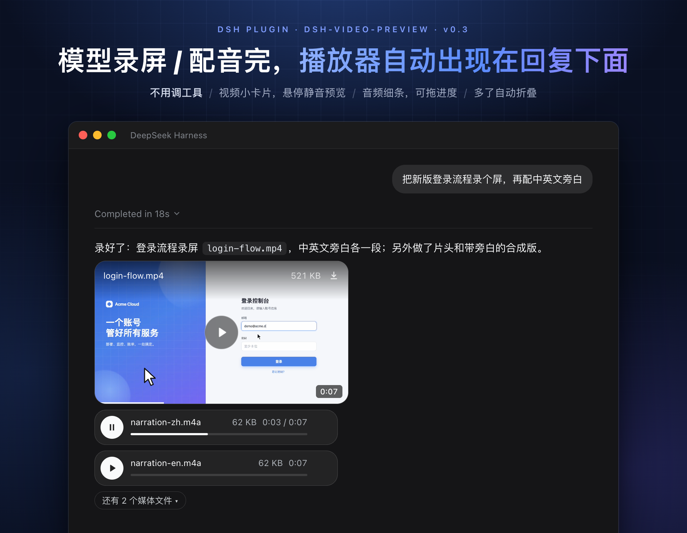
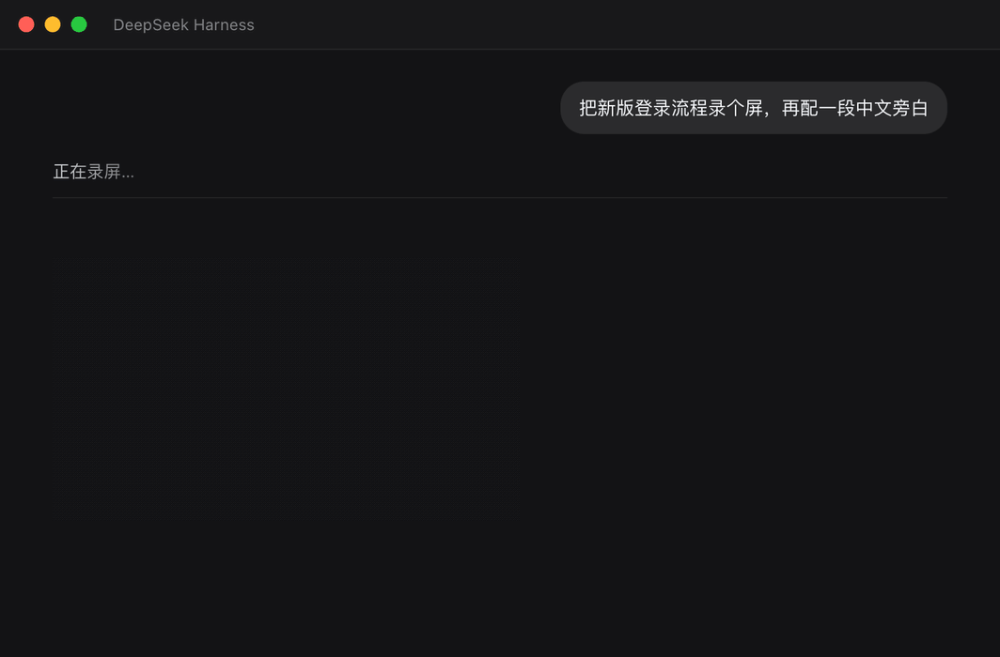

<div align="center">



<p>
  <a href="https://github.com/OrderG-X/dsh-video-preview/releases"></a>
  
  <a href="https://github.com/awesome-dsh-plugin/awesome-dsh-plugin"></a>
</p>

<p>
  <a href="README.md">简体中文</a> ·
  <a href="README.en.md"><b>English</b></a>
</p>

</div>



Play local video and audio right in the DSH (DeepSeek Harness) chat. When the model records the screen, transcodes a file or generates a voiceover, a player appears right under its reply at the end of the turn, in the same spot as in the Claude desktop app and Codex. Nothing to click, and the model doesn't have to call a special tool. You can also just say "Play ~/Movies/a.mp4".

The model can "look" too: `look_video` grabs a few frames across the timeline and tiles them into one image for the model, and also measures the audio, looks for black frames and checks whether phones can play it. After making a video, the model can check its own work, and when you say "that's not right" it can see which part you mean.

> **In one line:** a DeepSeek Harness (DSH) plugin that plays local video and audio right in the chat. Files the model makes by recording the screen, transcoding or generating voiceovers get a player under its reply automatically; other files play with the `play_video` tool; with `look_video` the model looks at the frames and listens to the audio itself.
>
> **Use it for:** after "Record my screen", "Convert this video to mp4" or "Generate a voiceover", when you want to watch or listen right in the chat.
>
> **Install:** on the DSH Plugins page, click Add plugin and enter `@orderg-x/dsh-video-preview` (an npm package; if npm can't be reached it switches to a mirror in China automatically), then restart DSH.



## Install

On the DSH Plugins page, click Add plugin and enter the package name:

```
@orderg-x/dsh-video-preview
```

This is an npm package. When you install by package name and DSH can't reach the official npm registry, it switches to a mirror in China (npmmirror) automatically, without going through GitHub. You can also enter the release package URL `https://github.com/OrderG-X/dsh-video-preview/releases/latest/download/dsh-video-preview.tgz`, but then GitHub must be reachable.

**Restart DSH** after installing (the client code is bundled when DSH starts, so the player won't show up until you restart). The plugin appears as "Video Player" on the DSH Plugins page.

**Updating:** on DSH 0.2.2 or later, open it on the Plugins page and click "Update to …". On older DSH, uninstall it and add it again as above. A new version can be installed about a day after release, because the pnpm that DSH uses skips brand-new versions by default. To get it right away, uninstall it and add the release tarball instead (a tarball install can't use Update later).

> **Upgrading from 0.3.x:** since 0.4.0 the package is named `@orderg-x/dsh-video-preview` (`dsh-video-preview` on npm is someone else's package). After installing the new version, remove the old "dsh-video-preview" on the Plugins page and restart DSH. While the old version is still installed, the new one won't start and the old one keeps working as usual; video links in earlier conversations still play.

For development you can link a local directory: enter this repo's absolute path in Add plugin. It installs as `link:`, and code changes also need a restart.

## What it solves

DSH's message renderer only has text / image / file / table blocks, **no video**, and tool call blocks are collapsed by default. This plugin adds inline playback using only the official plugin API (zero `@deepseek-ai/*` dependencies, the same mechanism as the official `present` tool).

After one `play_video` call, the user sees:

1. **A player under the reply** (the main spot): small cards, one per row
   - A video shows only the picture (200px tall, original aspect ratio), with the duration in a corner. Hover to preview it muted and reveal the file name / size / Download; click to play it from the start with sound
   - Audio is a thin strip: a round play button, file name, size, duration and a draggable progress bar
   - More than 3 are first folded into "N more media files"; only one plays sound at a time
   - Colors, corner radius and fonts use DSH's own design variables, so they follow the light/dark theme
2. **The deliverable file chip:** preview it in the sidebar to open a full-size player (DSH itself lists mp4 as not previewable; the plugin takes over here)
3. **A small player inside the tool block** (fallback): visible once you expand the tool call block

Media files the model hands over with its built-in `present` tool get a player automatically too.

## Automatic players (no tool call needed)

Video / audio the model generates during the turn (screen recordings, ffmpeg / avconvert transcodes, `say` voiceovers…) gets a player attached automatically when the turn wraps up:

- **How it finds them:** it digs media file paths out of this turn's command arguments, command output and reply text (paths with spaces, Chinese characters, `~`, relative paths and shell escapes all work)
- **Which ones:** only files newly written during this turn (files just downloaded or extracted count too); files that were already there are skipped. Files the reply text mentions come first, and files from commands are used only when the reply mentions none, so intermediate files don't flood the chat; at most 8 per turn
- **No duplicates:** files already played with `play_video` / `present` aren't attached again
- **Stopped midway:** if there's no time to attach them at wrap-up, they're added after the turn ends (visible when you reopen the conversation)

## Usage

Just say "Play /Users/me/Movies/a.mp4" in the chat, and the model calls `play_video`. Parameters:

| Parameter | Required | Description |
| --- | --- | --- |
| `path` | Yes | Local file path (`~` works; relative paths are resolved against the conversation's working directory) |
| `title` | No | Player title, defaults to the file name |
| `autoplay` | No | Start playing automatically (browsers usually block this) |
| `loop` | No | Loop playback |

## The model watches videos itself (look_video)

The model can't read a video file directly, so `look_video` watches it for the model:

- **Contact sheet:** grabs 4–12 frames spread evenly across the duration and tiles them into one image for the model, each tile labeled with its time. It can also look at just one stretch (`from` / `to`), or get full-size frames at specific moments (`at`, up to 6)
- **Listening:** almost silent throughout, silence at the start / end / middle, too quiet, clipping, sound on only one channel
- **Watching:** black frames (a black first frame makes the cover black), a picture that never moves, a long frozen stretch in the middle
- **Will phones play it:** reads the mp4 / mov header (no decoding) and checks codecs (H.264 10-bit / 4:4:4, hev1, AC-3, ALAC…), a header at the end of the file (a web page has to download the whole file before playing), above 4K, an unfinished recording; for each problem it gives the ffmpeg fix

How it works: the video is opened in an invisible Chrome / Edge on your machine to grab frames and decode the audio (the same setup as Design Studio's design check), about a second per look. Without Chrome / Edge installed, it gives only the file header info.

| Parameter | Required | Description |
| --- | --- | --- |
| `path` | Yes | Local file path (video or audio) |
| `at` | No | Times to see as full-size frames, e.g. `["0:12", "1:05.5"]` |
| `from` / `to` | No | Look at this stretch only |
| `frames` | No | How many frames go into the contact sheet (based on duration by default, up to 16) |

## What it can play

DSH's player runs on Chromium, so Chromium decides what plays:

| | Formats |
| --- | --- |
| Plays | Video mp4 / m4v / mov / webm / ogv, audio mp3 / wav / ogg / m4a / aac / flac / opus |
| Depends on codec | mkv / 3gp: depends on the codecs inside the file; if it can't play, a note under the player says so and gives a conversion command |
| Won't play | avi / flv / wmv / wma / ts / mpg / rmvb and so on: `play_video` says so right away and gives a conversion command |

To convert (requires [ffmpeg](https://ffmpeg.org/); on macOS, `brew install ffmpeg`):

```sh
ffmpeg -i in.avi -c:v libx264 -c:a aac -movflags +faststart out.mp4   # video
ffmpeg -i in.wma -c:a aac out.m4a                                      # audio
```

When playback fails, a note under the player tells you which case it is: the file was moved away, there's no permission, the plugin isn't loaded (restart DSH), or the codec isn't supported (with a conversion command).

## Security

DSH's local web server does no authentication of its own, and any web page in a browser can reach `127.0.0.1`, so the two playback routes guard themselves:

- **Media files only:** decided by extension, and a symlink counts as the real file it points to; everything else gets 403.
- **Against DNS rebinding and cross-site requests:** Host must be a local name or DSH's own address; cross-site requests and any Origin other than DSH's own are rejected.
- **Signed URLs** (`/dsh-video-preview/media`): token = HMAC(key, absolute file path). The key is stored in `~/.dsh/cache/dsh-video-preview.secret` (0600), and tokens stay valid across restarts and hosts on the same machine.
- **Sidebar / under-the-reply URLs** (`/dsh-video-preview/preview`, no token): the login cookie is checked by DSH's own `connection` service. Older DSH versions without that service accept only local connections.

Versions before v0.3.0 only checked the cookie name, so a web page could forge the cookie and read any file. Please upgrade.

## Architecture

```
server  play_video tool ──validate file──▶ return a signed URL
            │
            └─append deliverables/presented event (same channel as the official present tool)
auto    session/event collects this turn's paths → picks new files at agent/turn-stopping → same channel
look    look_video ──read file header (probe)──▶ temporary local server (random token, local only, Range)
            └─headless Chrome / Edge grabs frames + decodes audio ──▶ contact sheet saved to DSH attachments; image and check results go to the model together
routes  /dsh-video-preview/media    signed token · HTTP Range streaming (large files never loaded into memory)
        /dsh-video-preview/preview  DSH login · for the sidebar / under-the-reply player
client  turnTail slot / documentPreviews renderer / toolview slot
```

- `lib/index.js` — server: tools + deliverables events + the two streaming routes (a disk read error only drops the current request and never takes DSH down)
- `lib/look.js` — look_video: picking frame times, grabbing and tiling frames and measuring audio in the browser, audio / picture problems, the text for the model
- `lib/probe.js` — reads mp4 / mov boxes (no decoding): codecs, duration, frame rate, rotation, header position, phone compatibility rules
- `lib/browser.js` — headless Chrome / Edge (CDP over a pipe, closed automatically when idle)
- `lib/auto-present.js` — automatic players: digging out paths, picking new files, presenting them before the turn wraps up (anything appended after the turn ends only shows up once the conversation is reopened)
- `lib/client.js` — the client: player under the reply / sidebar preview / tool block fallback / error diagnosis (`exports.inject` is the client **short service name**; the package name there stays pending forever)
- `locale/*.json`, `icon.svg` — the card title, description and icon on the DSH Plugins page
- `cordis.patch.yml` — bundle patch (the `name` on the insert line must be the full package name; the client resolves the bundle by it)

## Tests

```sh
node test/test-routes.mjs   # gatekeeping, Range, HEAD, disk read errors, the tool's format hints
node test/test-client.mjs   # three mount points, video card / audio strip, folding, error diagnosis
node test/test-auto.mjs     # automatic players: new / old files, reply text first, path spellings, no duplicates, replays don't act
node test/test-look.mjs     # look_video: hand-built mp4s for the codec rules; with Chrome / Edge, samples in test/fixtures for black frames, mono, silence, frozen picture
```

## Verified

End-to-end on the DeepSeek Harness 0.2.1-rc.2 desktop app: the player under the reply (mp4 / HEVC mov / m4a, Chinese file names), sidebar preview and playback, the conversion hint for avi, the error after a file is moved away; requests with a forged login cookie are rejected; m4a and mp4 files the model made with say / avconvert (including Chinese file names with spaces), without calling `play_video`, got a player live at the end of the turn and played; video card hover preview / click to play / download, audio strip playback, folding and expanding with more than 3, and the colors in both light and dark themes.

`look_video` was tested on the DSH desktop app on the same machine with DeepSeek-V4.1-Flash: asked to check three videos for problems, the model called `look_video` on each of the three files by itself and reported the black frames, the clipping, and that the HEVC / WebM files won't play elsewhere. Asked whether something flashed around 1 second, the model used `from` / `to` to look at that short stretch frame by frame and answered in 11 seconds: a hard cut from black to a bright color.

Reference implementations: [@goodandready/dsh-image-gen](https://www.npmjs.com/package/@goodandready/dsh-image-gen) (the client plugin pattern) and the official `dsh-tool-present` (the deliverables channel).

## Feedback

Hit a problem or want a new feature? [Open an issue](https://github.com/OrderG-X/dsh-video-preview/issues/new/choose). When reporting a problem, include your DSH version and plugin version so it can be fixed faster.
