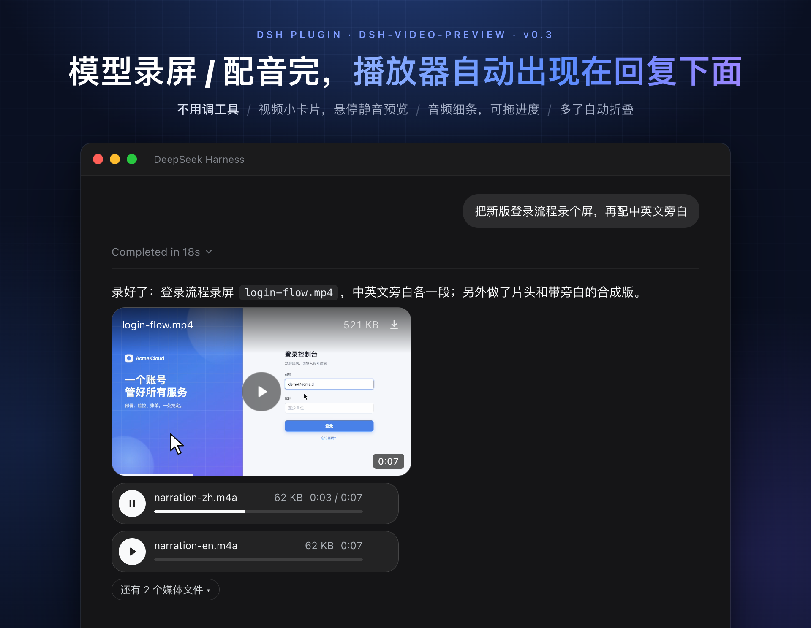
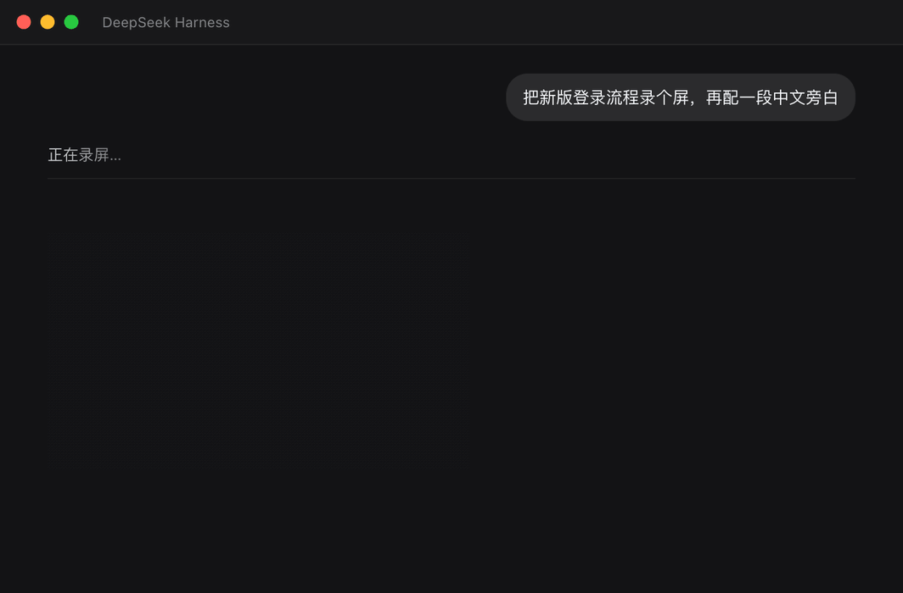

<div align="center">



<p>
  <a href="https://github.com/OrderG-X/dsh-video-preview/releases"></a>
  
  <a href="https://github.com/awesome-dsh-plugin/awesome-dsh-plugin"></a>
</p>

</div>



让 DSH（DeepSeek Harness）的对话流里直接播放本地视频 / 音频：模型录屏、转码、配音生成的文件，回合结束时播放器自动出现在回复正下方——Claude 桌面端 / Codex 同款位置，不用点任何东西，也不用模型专门调工具。说一句「播一下 ~/Movies/a.mp4」也行。

模型自己也能「看」：`look_video` 按时间截几帧拼成一张图交给模型，顺便量声音、找黑屏、查手机能不能播——做完视频它能自己检查，你说「不对」时它能看到你说的是哪一段。

> **一句话**：DeepSeek Harness（DSH）插件，在对话里直接播放本地视频和音频。模型录屏、转码、配音做出来的文件，播放器自动出现在回复下面；别的文件用 `play_video` 工具播；模型用 `look_video` 自己看画面、听声音。
>
> **什么时候用**：「录个屏」「把视频转成 mp4」「生成一段配音」之后，想直接在对话里看、听。
>
> **安装**：`dsh plugin add @orderg-x/dsh-video-preview`（npm 包），重启 DSH。
>
> **English:** a DeepSeek Harness (DSH) plugin that plays local video and audio inline in the chat. Files the model makes (screen recordings, transcodes, voiceovers) get a player under its reply automatically, and the `play_video` tool plays any other file. The `look_video` tool lets the model see a video itself: a contact sheet of frames, plus checks for silence, black frames and phone compatibility. Install with the `dsh plugin add` command above, then restart DSH.



## 安装

```sh
dsh plugin add @orderg-x/dsh-video-preview
```

也可以直接装发布包：`dsh plugin add https://github.com/OrderG-X/dsh-video-preview/releases/latest/download/dsh-video-preview.tgz`。装完**重启 DSH**（客户端代码在 DSH 启动时打包，不重启看不到播放器）。DSH「插件」页里显示为「视频播放」。

> **从 0.3.x 升级**：0.4.0 起包名改成 `@orderg-x/dsh-video-preview`（npm 上的 `dsh-video-preview` 是别人的包）。装上新版后，到「插件」页把旧的「dsh-video-preview」移除，再重启 DSH。旧版还在时新版不会启动，旧版照常能用；以前对话里的视频链接都还能播。

开发时可以直接链到本地目录：`dsh plugin --profile desktop add link:/path/to/dsh-video-preview`，改了代码同样要重启。

## 它解决什么

DSH 的消息渲染块只有 text / image / file / table，**没有 video**，工具调用块又默认折叠。这个插件用纯官方插件 API 补上内联播放（零 `@deepseek-ai/*` 依赖，和官方 `present` 工具同款机制）。

一次 `play_video` 调用后，用户能看到：

1. **回复下方的播放器**（主显示位）——小卡片，一个一行：
   - 视频只露画面（200 高、按原比例），角上标时长；鼠标移上去静音预览、浮出文件名 / 大小 / 下载，点一下从头带声音播
   - 音频是一条细条：圆形播放键、文件名、大小、时长、可拖的进度条
   - 超过 3 个先折叠成「还有 N 个媒体文件」；同一时间只有一个在出声
   - 配色、圆角、字体用 DSH 自己的设计变量，深浅色主题跟着走
2. **交付文件芯片**——点「在侧边栏预览」打开大屏播放器（DSH 原生把 mp4 列为「不可预览」，这里接管）
3. **工具块里的小播放器**（兜底）——展开工具调用块后可见

模型用自带 `present` 工具交付的媒体文件，也会自动出现播放器。

## 自动播放（不用调工具）

模型这一轮里生成的视频 / 音频（录屏、ffmpeg / avconvert 转码、`say` 配音……），回合收尾时自动挂上播放器：

- **怎么找**：从这一轮的命令参数、命令输出、回复正文里挖出媒体文件路径（带空格、中文、`~`、相对路径、shell 转义都认）
- **挂哪些**：只挂这一轮里新写出来的文件（刚下载、解压出来的也算），以前就有的不挂；回复正文提到的优先，没提才用命令里的，中间文件不刷屏；一轮最多 8 个
- **不重复**：已经用 `play_video` / `present` 播过的不再挂
- **中途停掉**：来不及在收尾时挂，会在回合结束后补上（重新打开会话可见）

## 用法

对话里直接说「播一下 /Users/me/Movies/a.mp4」，模型会调 `play_video`。参数：

| 参数 | 必填 | 说明 |
| --- | --- | --- |
| `path` | 是 | 本地文件路径（支持 `~`；相对路径按会话的工作目录算） |
| `title` | 否 | 播放器标题，默认文件名 |
| `autoplay` | 否 | 自动播放（浏览器通常会拦） |
| `loop` | 否 | 循环播放 |

## 模型自己看视频（look_video）

模型看不了视频文件本身，`look_video` 替它看：

- **截帧拼图**：按时长均匀截 4–12 帧，拼成一张图交给模型，每格标时间；也可以只看一段（`from` / `to`），或者要某几刻的大图（`at`，最多 6 张）
- **听声音**：整段几乎没声、开头 / 结尾 / 中间没声、声音太小、爆音（削波）、只有一边声道
- **看画面**：黑屏（第一帧黑会让封面变黑）、整段画面没动、中间一大段卡住
- **手机能不能播**：读 mp4 / mov 文件头（不解码），查编码（H.264 10bit / 4:4:4、hev1、AC-3、ALAC……）、文件头在末尾（网页要下完才能播）、超过 4K、没录完；有问题给出 ffmpeg 改法

怎么做的：在本机一个看不见的 Chrome / Edge 里打开视频截帧、解码声音（和设计工作台的体检同一套），看一次一秒左右。没装 Chrome / Edge 时只给文件头信息。

| 参数 | 必填 | 说明 |
| --- | --- | --- |
| `path` | 是 | 本地文件路径（视频或音频） |
| `at` | 否 | 要看大图的时间点，例如 `["0:12", "1:05.5"]` |
| `from` / `to` | 否 | 只看这一段 |
| `frames` | 否 | 拼图里截几帧（默认按时长，最多 16） |

## 能播什么

DSH 的播放器是 Chromium 内核，能播什么由它决定：

| | 格式 |
| --- | --- |
| 能播 | 视频 mp4 / m4v / mov / webm / ogv，音频 mp3 / wav / ogg / m4a / aac / flac / opus |
| 看编码 | mkv / 3gp：要看文件里的编码，播不了会在播放器下面说明并给出转码命令 |
| 播不了 | avi / flv / wmv / wma / ts / mpg / rmvb 等 —— `play_video` 会直接说明，并给出转码命令 |

转码（需要 [ffmpeg](https://ffmpeg.org/)，macOS 上 `brew install ffmpeg`）：

```sh
ffmpeg -i in.avi -c:v libx264 -c:a aac -movflags +faststart out.mp4   # 视频
ffmpeg -i in.wma -c:a aac out.m4a                                      # 音频
```

播放出错时，播放器下面会告诉你是哪种情况：文件被移走了、没有权限、插件没加载（要重启 DSH），还是编码不支持（附转码命令）。

## 安全

DSH 的本地网页服务本身不做鉴权，浏览器里任何网页都摸得到 `127.0.0.1`，所以两条播放路由自己把门：

- **只给媒体文件**：按扩展名判断，软链接按它指向的真实文件算；别的文件一律 403。
- **防 DNS 重绑定和跨站**：Host 必须是本机名或 DSH 自己的地址；跨站请求、Origin 不是 DSH 自己的都拒。
- **签名地址**（`/dsh-video-preview/media`）：token = HMAC(密钥, 文件绝对路径)，密钥存在 `~/.dsh/cache/dsh-video-preview.secret`（0600），同一台机器上跨重启、跨宿主都有效。
- **侧边栏 / 回复下方的地址**（`/dsh-video-preview/preview`，没有 token）：交给 DSH 自己的 `connection` 服务验登录 cookie；老版本 DSH 没有这个服务时只收本机连接。

v0.3.0 之前的版本只看 cookie 名字，网页能伪造 cookie 读到任意文件，请升级。

## 架构

```
服务端  play_video 工具 ──校验文件──▶ 返回带签名的 URL
            │
            └─append deliverables/presented 事件（官方 present 工具同款通道）
自动    session/event 收集这一轮的路径 → agent/turn-stopping 时挑出新文件 → 同一条通道
看视频  look_video ──读文件头（probe）──▶ 临时本机服务（随机口令、只收本机、Range）
            └─无头 Chrome / Edge 截帧 + 解码声音 ──▶ 拼图存进 DSH 附件库，图和体检结果一起交给模型
路由    /dsh-video-preview/media    签名 token · HTTP Range 流式（大文件不进内存）
        /dsh-video-preview/preview  DSH 登录态 · 供侧边栏 / 回复下方的播放器
客户端  turnTail 槽 / documentPreviews 渲染器 / toolview 槽
```

- `lib/index.js` —— 服务端：工具 + deliverables 事件 + 两条流式路由（读盘出错只断当前请求，不会带崩 DSH）
- `lib/look.js` —— look_video：取帧时间、浏览器里截帧拼图和量声音、声音 / 画面的问题、给模型的字
- `lib/probe.js` —— 读 mp4 / mov 的盒子（不解码）：编码、时长、帧率、旋转、文件头位置，手机兼容规则
- `lib/browser.js` —— 无头 Chrome / Edge（CDP 管道，闲置自动关）
- `lib/auto-present.js` —— 自动播放：挖路径、挑新文件、回合收尾前呈现（回合结束后才 append 的话，界面要重开会话才刷出来）
- `lib/client.js` —— 客户端：回复下方播放器 / 侧边栏预览 / 工具块兜底 / 出错诊断（`exports.inject` 是客户端**短服务名**，写包名会一直 pending）
- `locale/*.json`、`icon.svg` —— DSH 插件页的卡片标题、说明和图标
- `cordis.patch.yml` —— bundle patch（insert 行的 `name` 必须是完整包名，客户端按它解析 bundle）

## 测试

```sh
node test/test-routes.mjs   # 把门、Range、HEAD、读盘出错、工具的格式提示
node test/test-client.mjs   # 三个挂载点、视频卡 / 音频条、折叠、出错诊断
node test/test-auto.mjs     # 自动播放：新 / 老文件、正文优先、各种路径写法、不重复、重放不动手
node test/test-look.mjs     # look_video：手搓 mp4 测编码规则；有 Chrome / Edge 时用 test/fixtures 的样片测黑屏、单声道、没声、画面不动
```

## 已验证

DeepSeek Harness 0.2.1-rc.2 桌面端端到端实测：回复下方播放器（mp4 / HEVC 的 mov / m4a，中文文件名）、侧边栏预览和播放、avi 的转码提示、文件被移走后的出错提示；伪造登录 cookie 的请求被拒；模型用 say / avconvert 生成的 m4a、mp4（含带空格的中文文件名）没调 `play_video`，回合结束时播放器实时出现且能播；视频卡悬停预览 / 点击播放 / 下载、音频条播放、超过 3 个时折叠展开、深浅两种主题下的配色。

`look_video` 在同一台机器的 DSH 桌面端用 DeepSeek-V4.1-Flash 实测：用户说「三个视频帮我看看有没有问题」，模型自己对三个文件调 `look_video`，答出黑屏、爆音、HEVC / WebM 在别处放不了；问「1 秒左右是不是闪了一下」，模型用 `from` / `to` 逐帧看了那一小段，11 秒答出是黑场硬切到亮色。

参考实现：[@goodandready/dsh-image-gen](https://www.npmjs.com/package/@goodandready/dsh-image-gen)（客户端插件套路）与官方 `dsh-tool-present`（deliverables 通道）。

## 反馈

遇到问题或想要新功能，[提一个 issue](https://github.com/OrderG-X/dsh-video-preview/issues/new/choose)。报问题时写上 DSH 版本和插件版本，修起来最快。
